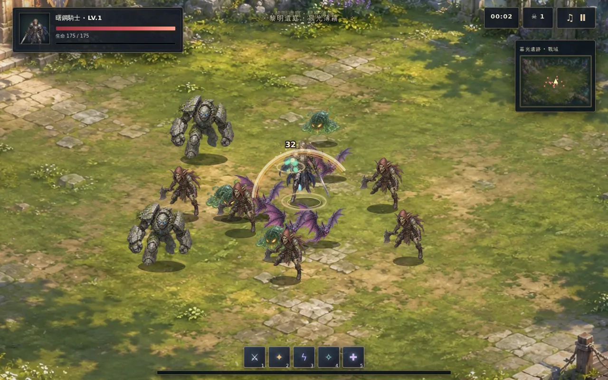
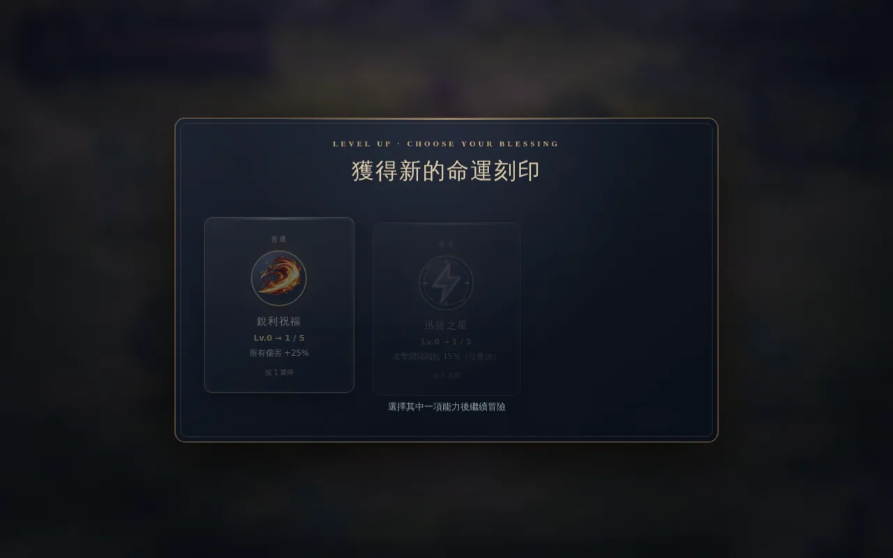

<p align="center">
  <a href="https://weskao.github.io/eclipse-survivors/" title="Play Eclipse Survivors">
    
  </a>
</p>

# Eclipse Survivors

**Version 1.0.0 — integrated game systems (release candidate).** All seven development branches now converge in this Vue 3 + TypeScript build. The active milestone introduces four selectable modes, persistent achievements and hero cosmetics, real skill evolutions, telegraphed multi-phase bosses, distinct biomes and world events, animated heroes, and interruption-safe audio.

**A playable fantasy survival-action browser game.** Choose your hero, fight through waves of dangerous creatures, collect experience gems, and discover increasingly powerful skill combinations. Defeat monstrous bosses, brave changing weather, and survive in a richly illustrated fantasy world — directly in your browser.

<p align="center">
  <a href="https://weskao.github.io/eclipse-survivors/"><strong>▶ PLAY THE GAME</strong></a>
  &nbsp;•&nbsp; <a href="CHANGELOG.md">What's New</a>
  &nbsp;•&nbsp; <a href="docs/release-process.md">Releases</a>
</p>

> **Real gameplay images:** All screenshots in this README are captured from the built game (`pnpm build`, output in `dist/`) using a headless browser. The app icon and social preview are composed exclusively from art assets already embedded in the game, rather than unrelated concept images.

## Actual Gameplay Screenshots

The images below show the current game as it runs in Chromium, not promotional mockups or artwork from another game.

<table>
<tr>
<td width="66%">
  
  <small><strong>Survival combat</strong> — automatic attacks, enemy waves, experience, and HUD.</small>
</td>
<td width="34%" rowspan="2">
  
  <small><strong>Mobile play</strong> — the actual touch-screen layout.</small>
</td>
</tr>
<tr>
<td>
  
  <small><strong>Level-up choices</strong> — select one of three upgrades during a run.</small>
</td>
</tr>
</table>

## Game Features

- **Four game modes:** Quick Run (150 seconds), Standard Adventure (8 minutes), Endless Survival, and Challenge Mode; timed wins require the appropriate boss to be defeated.
- **Persistent progression:** Personal records, achievements, cosmetic unlocks, permanent upgrades, encyclopedia entries and run statistics.
- **Five legendary evolutions:** Frozen Thunderstorm, Infernal Singularity, Apocalypse Rain, Blade Tempest and Guardian Sanctuary, with equipment-aware HUD.
- **Advanced enemy encounters:** Differentiated AI, ranged warlocks, elite enemies and multi-phase boss attacks with readable warnings.
- **Four distinct biomes and events:** Dawn Ruins, Thunder Sanctuary, Frozen Corridor and Ashen Battlefield, with interactive events and hazards.
- **Three hero classes:** Knight, Ranger, and Mage, each with different starting attributes and attacks.
- **Survival combat:** Move through enemy waves, avoid incoming threats, and earn experience from defeated monsters.
- **Choose your build:** Pick one of three upgrades each time you level up. Mix and strengthen up to 15 available abilities.
- **Elemental abilities:** Lightning, chain lightning, frost novas, meteors, flaming auras, vortexes, and shields.
- **Evolving atmosphere:** Explore an ancient battlefield through morning light, thunderstorms, snowfall, and drifting embers.
- **Boss encounters:** Survive long enough to challenge powerful enemies.
- **Grounded movement:** Smoother acceleration and more stable character proportions replace exaggerated pseudo-skeletal animation.
- **Cinematic audio:** A dark-fantasy selection-screen motif, battle soundtrack, and distinctive feedback for heroes, spells, upgrades, pickups, bosses, and UI actions. Music and effects can be muted separately.
- **Desktop and mobile:** Play with a keyboard or touch controls.

The character selection screen shows the **current published version** in its bottom bar. The release check verifies that this label matches the newest `CHANGELOG.md` version.

## Quick Start

**Play online:** [weskao.github.io/eclipse-survivors](https://weskao.github.io/eclipse-survivors/)

**Run locally:** Requires Node.js 24 and pnpm. See [Development](#development) below. Opening `dist/index.html` straight from disk (`file://`) does not work, because browsers block module scripts there. Serve it with `pnpm preview` instead.

> Browsers require a user gesture before audio playback. Tap or click the selection screen to unlock its cinematic music; gameplay music begins when you press **Start Adventure**. Music and SFX have independent, remembered toggles.

### Controls

| Action | Desktop | Mobile |
| --- | --- | --- |
| Move | `WASD` or arrow keys | On-screen joystick |
| Dash | `Space` | Dash button |
| Pause / resume | `P` or `Esc` | Pause button |
| Choose level-up ability | `1`, `2`, `3` or click | Tap your choice |
| Attack | Automatic | Automatic |

### Add the Game to Your Home Screen

**iPhone / iPad:** Open the website in Safari, use **Share → Add to Home Screen**, and add **Eclipse Survivors**.

**Android:** Open the website in Chrome, open the browser menu, and choose **Add to Home screen** or **Install app** if available.

The home-screen icon uses the knight sprite from the game. The social preview combines a live gameplay screenshot with the original knight and mage sprites. Both are generated from the game's own assets.

## Technology

- Vue 3, TypeScript, and Vite, built with pnpm
- HTML5 Canvas for the game world; Vue components for menus and HUD
- Static multi-file build with no required runtime CDN or game server
- Embedded original sound and visual assets, bundled locally by Vite
- GitHub Pages distribution
- Mobile app icons and social previews generated from actual in-game character art and gameplay
- Automated real-game browser screenshot capture for the README

## Integration Verification

The seven feature histories were merged into `feature/eclipse-survivors-v1-integration` without force pushing. The dedicated GitHub Actions workflow runs installation, TypeScript checks, Vitest, production build, release validation and Pages asset checks. A separate browser workflow records **actual running-game** screenshots on desktop, phone portrait and phone landscape, plus character, evolved-skill, biome and boss recordings. Media is uploaded as Actions artifacts rather than replaced by illustration mockups.

For the latest evidence, see [integration checks](https://github.com/weskao/eclipse-survivors/actions/workflows/v1-integration.yml) and [gameplay captures](https://github.com/weskao/eclipse-survivors/actions/workflows/v1-visual-evidence.yml). The existing screenshot gallery above remains an authentic Chromium capture of the game, while additional v1 captures are supplied in the CI artifacts.

## Development

Requirements: **Node.js 24** and **pnpm**. The pnpm version is pinned by the `packageManager` field in `package.json`; `corepack enable` provides it.

To start playing locally with one command from the repository root:

```sh
make dev             # installs dependencies when needed and opens the game in your browser
make dev PORT=5174   # use a different preferred local port
make help            # see all available shortcuts
```

Vite prints the actual local URL (normally `http://localhost:5173/`) and keeps running until you press **Ctrl+C**. If the preferred port is occupied, Vite chooses another free port. Other shortcuts include `make test`, `make typecheck`, `make build`, `make preview` and `make verify`.


```bash
pnpm install       # install dependencies (pnpm-lock.yaml is authoritative)
pnpm dev           # local dev server
pnpm test          # Vitest unit tests
pnpm typecheck     # strict TypeScript check (vue-tsc)
pnpm build         # static site in dist/
pnpm preview       # serve dist/ locally to check the production build
```

The build is a static multi-file site. Scripts, styles, art, and music are all bundled locally, with no CDN or third-party runtime dependency. Asset URLs are relative (`base: './'`), so `dist/` can be deployed under any sub-path, such as `https://<user>.github.io/eclipse-survivors/`.

The brand-asset export (`scripts/export-brand-assets.py`) serves `dist/`, so run `pnpm build` before it.

## Project Layout

```text
index.html                         Vite entry page
manifest.webmanifest               Home-screen web app metadata
package.json, pnpm-lock.yaml       Dependencies, scripts and pinned pnpm version
vite.config.ts                     Build config (relative base) and Vitest settings
src/main.ts                        Vue app entry
src/game/                          Game engine modules: state, input, math, audio, render (TypeScript)
src/components/                    Vue 3 UI: menus, HUD and level-up screens
src/assets/                        Art and music bundled by Vite (for example bgm.mp3)
assets/icon-192.png                App icon based on in-game knight sprite (generated)
assets/apple-touch-icon.png        iOS home-screen icon (generated)
assets/icon-512.png                High-resolution home-screen icon (generated)
assets/og-cover.png                Social preview: real gameplay and in-game sprites
assets/screenshots/                Screenshots captured from actual gameplay
tests/                             Python brand-asset tests + Vitest release checks; other suites beside their source
scripts/export-brand-assets.py     Generate raster assets and capture screenshots (needs dist/)
.github/workflows/brand-assets.yml Artwork generation workflow
.github/workflows/release.yml      Verification and GitHub Pages publishing
CHANGELOG.md                       Player-facing changes
docs/release-process.md            Publishing and version guidelines
```

## Status and Artwork

Eclipse Survivors is an evolving **playable prototype**. All images displayed above are captured directly from the running game. The installed app icon and share cover use original embedded game sprites; no external fantasy-game screenshots or concept art are presented as gameplay.

## License

No open-source license has been granted for this repository. All rights are reserved unless explicitly stated otherwise.

### ES4 talent-tree feature switch

`VITE_ES4_HALL=0` (default or unset) keeps the original five permanent research nodes and V3 progression. Set `VITE_ES4_HALL=1` in `.env.local` or pass it to Vite to expose the expanded tree. Restart the dev server or rebuild after changing it.

```sh
VITE_ES4_HALL=0 make dev          # original ES2 research only
VITE_ES4_HALL=1 make dev-unlocked # actual ES4 purchase and combat, disposable V4 guest save
VITE_ES4_HALL=1 make phone-unlocked # same on LAN/mobile
VITE_ES4_HALL=0 make build        # default public build
```

The ES4 flag does not grant unlocked mode on its own. A normal enabled build shows a read-only preview until release approval; unlocked DEV ES4 uses in-memory saves and disables the cloud-wallet adapter even with the emulator. Switching off does not delete or downgrade saved data. The centralized policy in `src/game/content/meta/hall-feature.ts` is the only place that reads the flag; remove the temporary switch after full production approval and migration safety verification.
