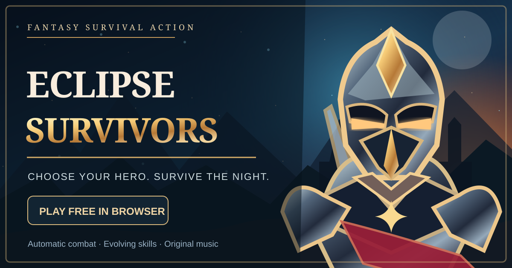
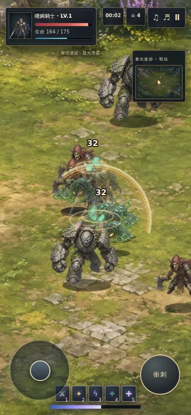

<p align="center">
  <a href="https://weskao.github.io/survivor-game/" title="Play Eclipse Survivors">
    
  </a>
</p>

# Eclipse Survivors

**An atmospheric fantasy survival-action game.** Choose your hero, fight through waves of dangerous creatures, collect experience gems, and discover increasingly powerful skill combinations. Defeat monstrous bosses, brave changing weather, and survive in a richly illustrated fantasy world — directly in your browser.

<p align="center">
  <a href="https://weskao.github.io/survivor-game/"><strong>▶ PLAY THE GAME</strong></a>
  &nbsp;•&nbsp; <a href="CHANGELOG.md">What's New</a>
  &nbsp;•&nbsp; <a href="docs/release-process.md">Releases</a>
</p>

> **Playable prototype:** The current game is a self-contained browser adventure. The cover artwork is promotional illustration, not an in-game screenshot. The gameplay images below are captured from the actual game by the artwork workflow. They appear when that workflow completes successfully.

## Gameplay

<p align="center">
  
  
</p>

Fight, move, dodge, and level up. Your hero attacks automatically, leaving you free to concentrate on positioning and building a powerful combination of abilities.

## Game Features

- **Three hero classes:** Knight, Ranger, and Mage, each with different starting attributes and attacks.
- **Survival combat:** Move through enemy waves, avoid incoming threats, and earn experience from defeated monsters.
- **Choose your build:** Pick one of three upgrades each time you level up. Mix and strengthen up to 15 available abilities.
- **Elemental abilities:** Lightning, chain lightning, frost novas, meteors, flaming auras, vortexes, and shields.
- **Evolving atmosphere:** Explore an ancient battlefield through morning light, thunderstorms, snowfall, and drifting embers.
- **Boss encounters:** Survive long enough to challenge powerful enemies.
- **Grounded movement:** Smoother acceleration and more stable character proportions replace exaggerated pseudo-skeletal animation.
- **Original music and sound effects:** All essential game audio and artwork are embedded in the HTML.
- **Desktop and mobile:** Play with a keyboard or touch controls.

## Quick Start

**Play online:** [weskao.github.io/survivor-game](https://weskao.github.io/survivor-game/)

**Play offline:** Download `index.html` and open it in a modern browser. No build tools, extra packages, or server are needed.

> Browsers normally require a user interaction before playing audio. Background music starts after you select a class and press **Start Adventure**.

### Controls

| Action | Desktop | Mobile |
| --- | --- | --- |
| Move | `WASD` or arrow keys | On-screen joystick |
| Dash | `Space` | Dash button |
| Pause / resume | `P` or `Esc` | Pause button |
| Choose level-up ability | `1`, `2`, `3` or click | Tap your choice |
| Attack | Automatic | Automatic |

### Add the Game to Your Home Screen

**iPhone / iPad:** Open the website in Safari, use **Share → Add to Home Screen**, and add **Eclipse Survivors**.

**Android:** Open the website in Chrome, open the browser menu, and choose **Add to Home screen** or **Install app** if available.

The home-screen icon and social preview are derived from the project's own fantasy branding, with SVG artwork kept as the editable source.

## Technology

- HTML5 Canvas, JavaScript, and CSS
- Self-contained game with no required runtime CDN or game server
- Embedded original sound and visual assets
- GitHub Pages distribution
- Mobile app icons and social previews generated from original SVG artwork
- Automated real-game browser screenshot capture for the README

## Project Layout

```text
index.html                       Standalone playable game
manifest.webmanifest             Home-screen web app metadata
assets/app-icon.svg              Editable app icon artwork
assets/og-cover.svg              Editable cover artwork
assets/apple-touch-icon.png      iOS home-screen icon (generated)
assets/icon-192.png              Home-screen icon (generated)
assets/icon-512.png              High-resolution home-screen icon (generated)
assets/og-cover.png              Open Graph preview image (generated)
assets/screenshots/              Screenshots captured from actual gameplay
scripts/export-brand-assets.py   Generate raster assets and capture screenshots
.github/workflows/brand-assets.yml Artwork generation workflow
.github/workflows/release.yml    GitHub Pages publishing
CHANGELOG.md                     Player-facing changes
docs/release-process.md          Publishing and version guidelines
```

## Status and Artwork

Eclipse Survivors is an evolving **playable prototype**. Promotional artwork conveys the intended visual direction; it should not be mistaken for footage of features that have not been implemented. For the current experience, use the gameplay screenshots and play the live build.

## License

No open-source license has been granted for this repository. All rights are reserved unless explicitly stated otherwise.
