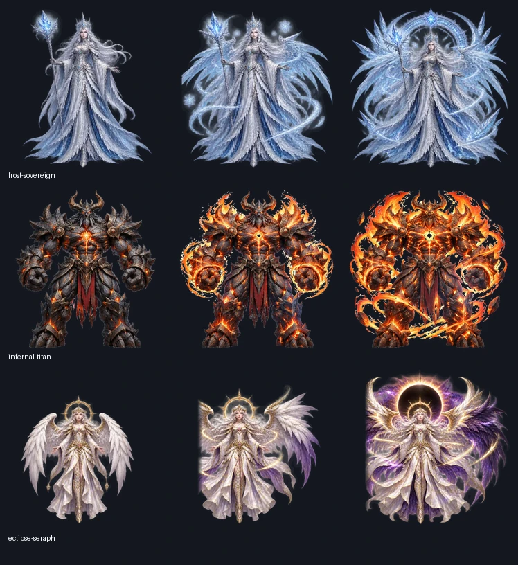

# ES2 Boss 原生 3×：實際 Canvas 三階段驗收證據

- 來源規格：[`02-bosses-4.md`](02-bosses-4.md)
- 整合程式：`src/game/render/es2/production-world.ts`、`src/game/engine.ts`
- 僅供開發環境：`?showcase=1&es2BossArtQa=<boss-id>`
- 四位 Boss：`abyss-monarch`、`frost-sovereign`、`infernal-titan`、`eclipse-seraph`
- **所有新候選圖片維持 `QA_PENDING`，正式版沿用原圖。**

## 自動驗證

在依照專案指示安裝依賴與 Playwright Chromium 後，啟動 Vite 開發伺服器（port 4174）並執行：

```bash
pnpm exec vitest run src/game/boss-art-qa-scenario.test.ts src/game/render/es2/production-world.test.ts src/assets/es2/production/bosses/candidates/
pnpm exec vite --host 127.0.0.1 --port 4174 --strictPort
# 另一終端執行
PREVIEW_URL=http://127.0.0.1:4174/ node scripts/es2-boss-art-qa-browser.mjs
```

腳本透過真正的 Vue、Vite、Boss Controller 和 Canvas 繪製場景，依序截取 4 位 Boss × 3 階段 × 3 裝置比例＝36 張 PNG，保存至 `artifacts/es2-mobile-browser/boss-art-qa/`。每張截圖附相同的 ID、Phase 與 viewport JSON 資料；會檢查候選 WebP 在瀏覽器真實解碼為 2268×756，以及 Controller snapshot ID、phase 正確。

## 人工驗收仍需逐格確認

- 與舊版及原始 `imgs7.png`／`imgs8.png` 對照：角色身分、頭飾、裝甲、翼型、三階段外觀一致。
- 原生來源與透明度：724×724 可見繪製內容、16px 安全邊距，不能誤用周圍格／透明 checkerboard。
- 實際畫面：桌面、手機直向與橫向中 Boss 本體不裁切、不蓋住重要 HUD，且縮放、視覺 FX、血條顯示合適。
- 技術測試與瀏覽器截圖**不等於**獲授權的人工作品核准；未經核准不可變更 `needs-human-approval`、`visual-review-required` 或將候選自動替換正式玩家素材。

## CI

獨立測試分支 `feature/es2-boss-art-real-chromium-qa` 有專用 `.github/workflows/es2-boss-art-real-qa.yml`，保存的圖片只供人工核對；不建立 PR、不合併 develop/main、不部署。

## 既有候選圖的 1× 實際像素視覺比對（非遊戲截圖）



此圖直接解碼當前三份候選 WebP（Frost Sovereign、Infernal Titan、Eclipse Seraph），使用每格內部 724px 原圖以 Lanczos 縮至 236×236，並以深色實心背景做正常 alpha 合成，**不是 AI 偽造的遊戲畫面**，亦未更改遊戲素材。圖片 SHA-256：`7b7b6605fcb2cacde4b9f593e9325679aa81151ed35cb81eccf05d3d34ffe9d6`。

透明背景在未合成的檢視工具中可能顯示鮮豔 RGB 假色；真正評估應使用 alpha 合成結果而非只看 RGBA 原始 RGB 通道。這三份 atlas 每個來源格在 alpha > 16 門檻的四側邊線均為零個非透明像素，尚須實際 Chromium gameplay、角色身分比對、以及獲授權人工簽核。Abyss Monarch 不包含於此三人比對圖。
